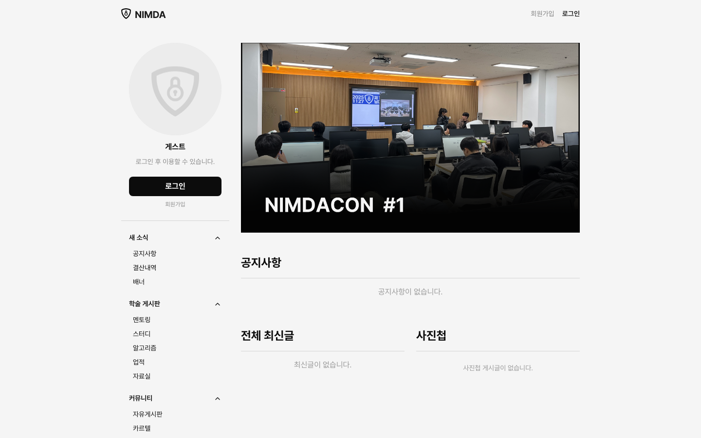
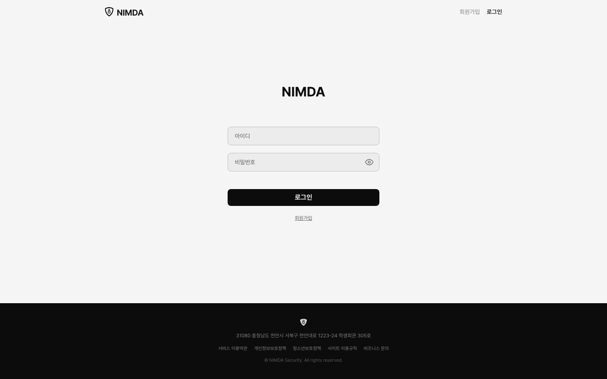
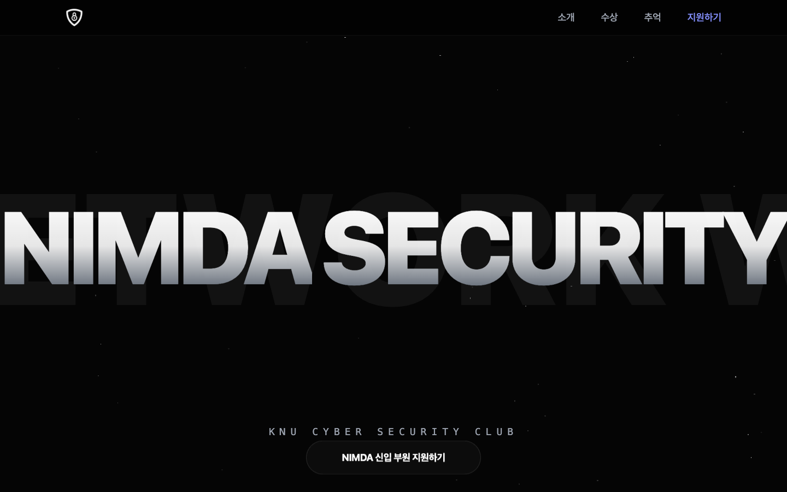
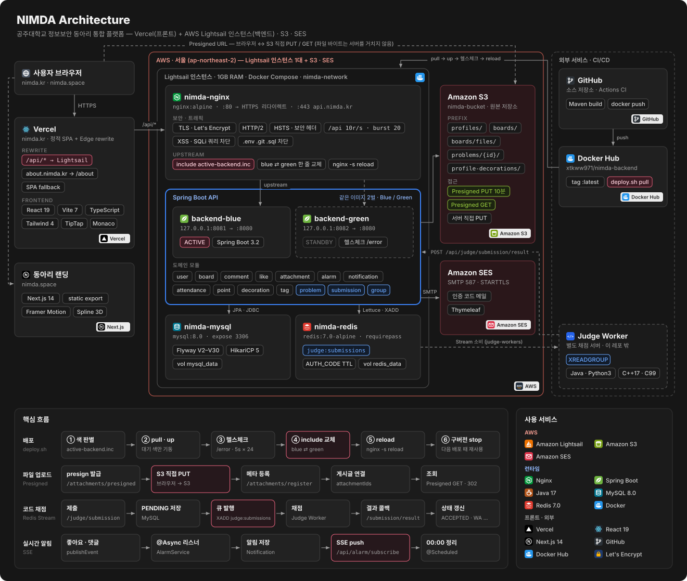
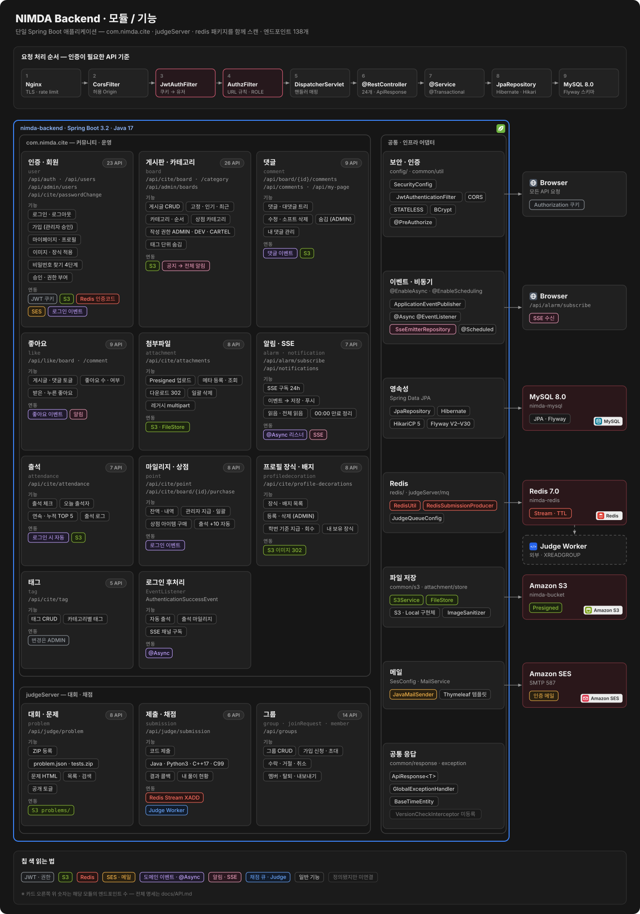

<div align="center">

<picture>
  <source media="(prefers-color-scheme: dark)" srcset="NimdaLandingPage/public/NimdaLogo_W.png">
  
</picture>

# NIMDA

**공주대학교 정보보안 동아리 NIMDA의 통합 웹 플랫폼**<br>
커뮤니티 · 동아리 운영 · 자체 대회(님다콘)를 하나의 서비스로 연결합니다.

[](https://nimda.kr)
[](https://about.nimda.kr)
[](./docs/API.md)
[](https://github.com/Nimda-Security/Nimda)

[Features](#key-features) · [Tech Stack](#tech-stack) · [Screenshots](#screenshots) · [Architecture](#architecture) · [API](#api) · [Structure](#directory-structure) · [Team](#team)

</div>

---

## About

흩어져 있던 공지 · 자료 공유, 회원 관리, 활동 기록, 교내 대회 운영을 **하나의 동아리 전용 플랫폼**으로 합쳤습니다.

가입은 관리자 승인제로 운영되고, 출석과 활동에 따라 마일리지가 쌓여 배지와 프로필 장식으로 돌아옵니다. 동아리 자체 대회인 **님다콘**도 같은 계정으로 참여합니다.

> 서비스는 [nimda.kr](https://nimda.kr), 동아리 소개와 신입 부원 지원은 [about.nimda.kr](https://about.nimda.kr)에서 볼 수 있습니다.

---

## Key Features

<table>
<tr>
<td width="50%" valign="top"><b>회원 · 권한</b><br>승인제 가입 · 쿠키 기반 JWT 인증 · 역할별 게시판 권한</td>
<td width="50%" valign="top"><b>커뮤니티</b><br>카테고리 · 태그별 게시판 · 리치 에디터 · 댓글 · 좋아요</td>
</tr>
<tr>
<td valign="top"><b>실시간 알림</b><br>댓글 · 좋아요 · 공지를 SSE로 즉시 전달</td>
<td valign="top"><b>활동 보상</b><br>자동 출석 · 마일리지 · 배지 · 프로필 장식 상점</td>
</tr>
<tr>
<td valign="top"><b>님다콘</b><br>문제 출제 · 코드 제출 · 채점 · 스코어보드 (2025.11 제1회 개최)</td>
<td valign="top"><b>운영 도구</b><br>가입 승인 · 권한 · 카테고리 · 게시글 · 마일리지 관리</td>
</tr>
<tr>
<td valign="top"><b>파일 업로드</b><br>S3 Presigned URL로 브라우저에서 직접 전송</td>
<td valign="top"><b>무중단 배포</b><br>Blue-Green 전환 + Nginx graceful reload</td>
</tr>
</table>

---

## Tech Stack

| 분류 | 기술 |
| --- | --- |
| **Frontend** |      |
| **Backend** |      |
| **Data** |    |
| **Infra · Deploy** |        |

---

## Screenshots

| 메인 | 로그인 | 동아리 소개 |
| :-: | :-: | :-: |
|  |  |  |

---

## Architecture

<p align="center"></p>

- **프론트** — Vercel의 정적 SPA. `/api/*`만 Lightsail 인스턴스로 rewrite해서, 브라우저 입장에선 같은 출처라 `HttpOnly` JWT 쿠키가 그대로 동작합니다.
- **백엔드** — AWS Lightsail 인스턴스 한 대(1GB RAM)에서 Docker Compose로 Nginx · Spring Boot ×2 · MySQL · Redis를 운영합니다. DB와 Redis는 외부 포트가 없습니다.
- **파일** — 브라우저가 Presigned URL로 S3에 직접 올리고 받습니다. 서버는 URL 발급과 메타데이터 저장만 합니다.
- **채점** — 제출을 Redis Stream에 넣으면 별도 Judge Worker가 소비하고, 결과를 콜백 API로 돌려줍니다.
- **배포** — Blue-Green. `nginx/conf.d/active-backend.inc` 한 줄을 바꾸고 `nginx -s reload`로 무중단 전환합니다.

<details>
<summary><b>백엔드 모듈 · 기능 상세 보기</b></summary>
<br>
<p align="center"></p>
</details>

---

## API

엔드포인트 **138개** — 요청 · 응답 · 권한 · DTO 스키마 전체는 **[docs/API.md](./docs/API.md)** 에 있습니다.

| 모듈 | 경로 | API | 권한 |
| --- | --- | :-: | --- |
| [인증 · 회원](./docs/API.md#auth) | `/api/auth` · `/api/users` · `/api/cite/passwordChange` | 13 | 공개 (로그인 · 가입 · 비밀번호 찾기) / 로그인 |
| [관리자 · 회원 관리](./docs/API.md#admin-user) | `/api/admin/users` | 10 | ADMIN |
| [게시판](./docs/API.md#board) | `/api/cite/board` · `/api/admin/boards` | 18 | 로그인 / ADMIN |
| [카테고리](./docs/API.md#category) | `/api/cite/category` | 8 | 조회 공개 / 변경 ADMIN |
| [댓글](./docs/API.md#comment) | `/api/board/{id}/comments` · `/api/comments` | 9 | 로그인 / 숨김은 ADMIN |
| [좋아요](./docs/API.md#like) | `/api/like/board` · `/api/like/comment` | 9 | 로그인 |
| [첨부파일 · S3](./docs/API.md#attachment) | `/api/cite/attachments` | 8 | 로그인 / `download-url` 공개 |
| [알림 · SSE](./docs/API.md#notification) | `/api/alarm/subscribe` · `/api/notifications` | 7 | 로그인 |
| [출석](./docs/API.md#attendance) | `/api/cite/attendance` | 7 | 로그인 / 오늘 출석자 공개 |
| [마일리지 · 상점](./docs/API.md#point) | `/api/cite/point` · `/api/cite/board/{id}/purchase` | 8 | 로그인 / ADMIN |
| [프로필 장식 · 배지](./docs/API.md#decoration) | `/api/cite/profile-decorations` | 8 | 조회 공개 / 관리 ADMIN |
| [태그](./docs/API.md#tag) | `/api/cite/tag` | 5 | 조회 공개 / 변경 ADMIN |
| [대회 · 문제](./docs/API.md#problem) | `/api/judge/problem` | 8 | 로그인 / ADMIN |
| [제출 · 채점](./docs/API.md#submission) | `/api/judge/submission` | 6 | 로그인 |
| [그룹](./docs/API.md#group) | `/api/groups` | 14 | 로그인 / ADMIN |

---

## Directory Structure

```text
Nimda/
├── NimdaConFrontEnd/              # 메인 서비스 (React 19 · Vite · TS) → Vercel
│   └── src/
│       ├── api/                   # 백엔드 모듈별 fetch 래퍼
│       ├── domains/               # 화면 단위 — Home · Board · Comment · Contest · User · admin
│       ├── components/            # Layout · Notification · ProtectedRoute · 공용 UI
│       └── Router.tsx             # 라우팅 · 로그인/관리자 보호 경로
│
├── NimdaConBackEnd/backend-spring/    # API 서버 (Spring Boot 3.2 · Java 17)
│   └── src/main/
│       ├── java/
│       │   ├── com/nimda/cite/    # 커뮤니티 · 운영
│       │   │   ├── config/        #   SecurityConfig · JwtAuthenticationFilter · SesConfig
│       │   │   ├── common/        #   ApiResponse · 예외 · S3 · JWT · Mail
│       │   │   ├── user/          #   인증 · 회원 · 관리자 회원 관리
│       │   │   └── domain/        #   board · comment · like · attachment · alarm · notification
│       │   │                      #   attendance · point · profiledecoration · tag
│       │   ├── judgeServer/       # 대회 · 채점 — problem · submission · group
│       │   └── redis/             # RedisConfig · RedisUtil
│       └── resources/
│           ├── db/migration/      # Flyway 마이그레이션 (V2–V30)
│           └── application.yml
│
├── NimdaLandingPage/              # 동아리 소개 (Next.js 14 static export)
├── nginx/                         # 리버스 프록시 · TLS · Blue-Green upstream
├── docker-compose.yml             # Nginx · backend-blue/green · MySQL · Redis
├── deploy.sh                      # Blue-Green 무중단 배포 스크립트
└── docs/
    ├── API.md                     # API 명세
    ├── architecture/              # 아키텍처 다이어그램
    └── screenshots/               # README 화면 캡처
```

---

## Team

### Backend · Infra

<table>
<tr>
<td width="50%" valign="top">


**최도일** · [@novvvv](https://github.com/novvvv)<br>
`Backend · Infra`
<br clear="left">

- 회원 · JWT 인증 · 권한 도메인, 가입 승인 관리자 API
- 카테고리 도메인 · 게시판 목록 / 고정글 / 인기글 API
- Spring Security 초기 설계 · Flyway 도입
- Nginx(SSL · 보안 헤더) · Docker Compose · GitHub Actions CI/CD 초기 구축
- 채점 서버 · 스터디 그룹 초기 버전, 관리자 대시보드 · 문제 출제 화면

</td>
<td width="50%" valign="top">


**이도현** · [@xtkww971](https://github.com/xtkww971)<br>
`Backend · Contest · CI/CD · Infra`
<br clear="left">

- 대회 도메인 (문제 · 제출 · 채점 연계)
- CTF 서버 설계
- Blue-Green 파이프라인 구현
- S3 문제 파일 스토어
- AWS Util 구현
- CI/CD · 배포 안정화

</td>
</tr>
<tr>
<td width="50%" valign="top">


**이명건** · [@maenggeon](https://github.com/maenggeon)<br>
`Backend · Domain`
<br clear="left">

- 마일리지 일괄 지급 · 포인트 도메인
- 댓글 · 좋아요 · 출석 · 알림
- `ROLE_DEV` 등 권한 정책
- Group 도메인 · Cite 구조 분리

</td>
<td width="50%" valign="top">


**주윤호** · [@YknowsGit](https://github.com/YknowsGit)<br>
`Backend · Storage`
<br clear="left">

- AWS S3 연동 · 첨부파일 파이프라인
- CI S3 환경변수 · 시크릿 정리
- JWT / Common 모듈 정리
- 게시판 · 관리자 FE 연동

</td>
</tr>
</table>

### Frontend · Design

<table>
<tr>
<td width="50%" valign="top">


**서윤** · [@nuyoes](https://github.com/nuyoes)<br>
`Frontend Lead · Product`
<br clear="left">

- 게시판 · 댓글 · 에디터 UX
- 마이페이지 · 프로필 · 배지 시스템
- 마일리지 상점 · 구매 플로우
- 레이아웃 · 알림 · 랜딩 기여

</td>
<td width="50%" valign="top">


**정푸른** · [@JungBlue](https://github.com/JungBlue)<br>
`Frontend · Design`
<br clear="left">

- BoardList · 탭 · 고정글 UI 폴리시
- 동아리 랜딩 페이지 디자인 · 구현
- 마이페이지 마일리지 UI
- 비밀번호 변경 MCP 연동

</td>
</tr>
</table>

함께한 모든 기여자는 [Contributors](https://github.com/Nimda-Security/Nimda/graphs/contributors)에서 볼 수 있습니다.

---

## License & Contact

© NIMDA Security. All rights reserved.<br>
별도의 오픈소스 라이선스를 적용하지 않은 저장소입니다.

- **버그 · 기능 제안** — [GitHub Issues](https://github.com/Nimda-Security/Nimda/issues)
- **신입 부원 지원** — [about.nimda.kr](https://about.nimda.kr) 에서 지원하기
- **동아리방** — 충청남도 천안시 서북구 천안대로 1223-24 학생회관 305호
- **문서** — [API 명세](./docs/API.md) · [배포 가이드](./DEPLOYMENT.md)

<br>

<div align="center">
<sub>Made by NIMDA Security · Kongju National University</sub>
</div>
